<div align="center">

# EmailBridge

**Open-source mail gateway.** Connect any mailbox, send through a durable queue, and turn every mailbox
change into signed webhooks — with a full admin UI, a clean REST API and SDKs.

[](LICENSE)


[Features](#features) · [Screenshots](#screenshots) · [Quick start](#quick-start) · [API](#using-the-api) ·
[Webhooks](#webhooks) · [Deployment](#deployment) · [Docs](#documentation)

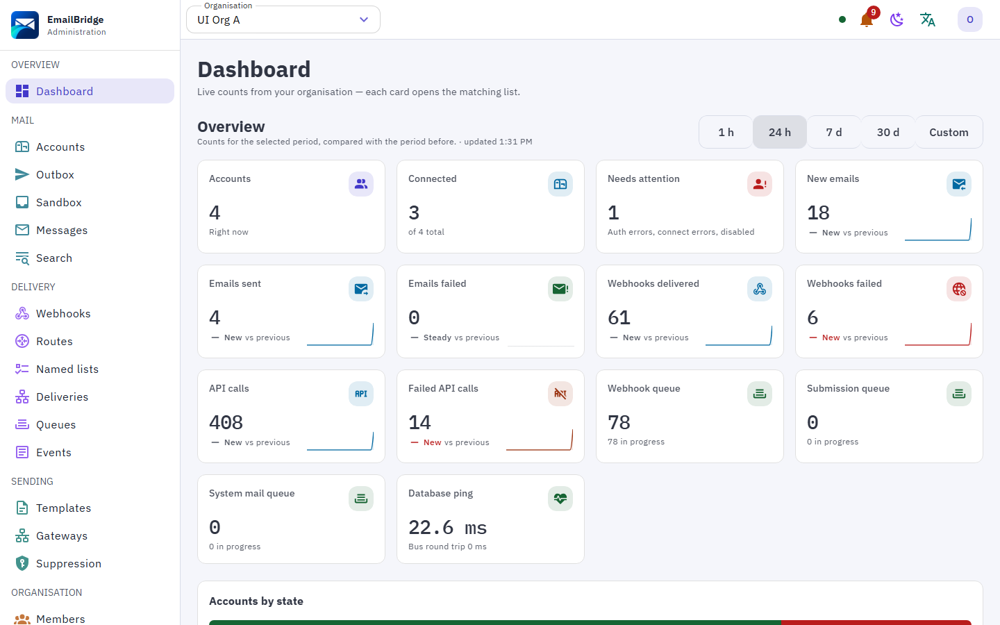

</div>

## Why EmailBridge

Applications that work with email — CRMs, helpdesks, legal and accounting tools — keep rebuilding the same
plumbing: IMAP sync that survives disconnects, reliable sending, bounce handling, and a way to react to
new mail. EmailBridge is that plumbing as one self-hosted service:

- **One API for every mailbox.** IMAP/SMTP, Gmail and Microsoft 365 accounts look the same to your app.
- **Mail becomes events.** New, sent, bounced, opened, clicked — every change is an event your app receives
  as a signed webhook, filtered and reshaped by rules you write in the admin UI.
- **Sending you can trust.** A durable queue with retries, error classification and rate limits, so a
  message is never lost or sent twice.
- **Runs anywhere.** A single container on a small server, or a role-split cluster on Kubernetes or AWS.

## Features

### Mailboxes
- IMAP/SMTP accounts with IDLE, CONDSTORE/QRESYNC and automatic reconnects.
- **Gmail API** and **Microsoft Graph** accounts with OAuth2, push notifications and delta sync; delegated
  and shared mailboxes.
- Folders, threads, flags, moves, drafts, attachments (with optional antivirus scan) and raw source.
- **Full-text search** across mailboxes, and optional **semantic search** through an AI provider.
- Account exports and archive; per-account metadata you can filter and route on.
- **Italian certified mail (PEC)**: sending, delivery receipts, signature checks and evidence archive.

### Sending
- Durable submit queue with retries, error classification (temporary / permanent) and per-account rate
  limits.
- Structured messages, raw MIME, replies, mail merge, scheduled sending and dry runs.
- **Templates** in Handlebars and MJML, rendered per recipient and language.
- Suppression lists, bounce and complaint handling, list unsubscribe.
- Open and click tracking, List-ID, copy to Sent.
- Sending gateways: SMTP relays and providers such as SES, Postmark, SendGrid, Mailgun and Brevo.

### Webhooks and events
- 30 event types (`message.received`, `message.sent`, `message.bounced`, `tracking.opened`, `pec.receipt`,
  `account.state_changed`, …) in **CloudEvents** format, with JSON Schemas.
- **Standard Webhooks** signatures, mTLS, custom headers and secret rotation.
- **Filter & transform rules** per endpoint, written in CEL or built visually, with presets and a test
  panel that runs the rule on real recent events.
- Ordered or parallel delivery, retries with backoff, dead-lettering, replay of past events.
- Sinks besides HTTP: NATS, Kafka, Amazon SQS and SNS, Google Pub/Sub.

### Admin UI
- Vue 3 + Vuetify, light and dark themes, works on phones, **9 languages** (en, it, es, fr, de, pt, ru,
  zh, ja).
- Accounts, messages, outbox, events, deliveries, queues, logs and per-account protocol transcripts, audit
  log, dashboard with KPIs.
- Organisations, members and roles; API keys with per-resource scopes.
- Sign-in with password, **passkeys**, TOTP and email codes, or **OIDC SSO** (Keycloak, Authentik, Entra,
  Google, Okta).
- Branded hosted connect page: logos, colour palette and custom header HTML.

### Integrations and AI
- Integrations catalogue: Slack, Teams, Discord, Telegram, Mattermost, HubSpot, Pipedrive, Google Drive,
  OneDrive, Grafana, Loki, Sentry, Rspamd and more.
- Built-in **MCP server**, so AI agents (Claude, Cursor and others) can use the whole API with a scoped key.
- Optional AI providers (OpenAI, Anthropic, Gemini, xAI) for semantic search.

### Operations
- Multi-tenant with organisations; GDPR export and erasure.
- Cluster mode on NATS JetStream: leases move accounts between nodes, roles can run on separate processes.
- Prometheus metrics and alert rules, OpenTelemetry tracing, Sentry-compatible error reporting, structured
  logs with redaction.
- Config as code: plan, apply and export the whole setup as YAML.

## Screenshots

| | |
| --- | --- |
| 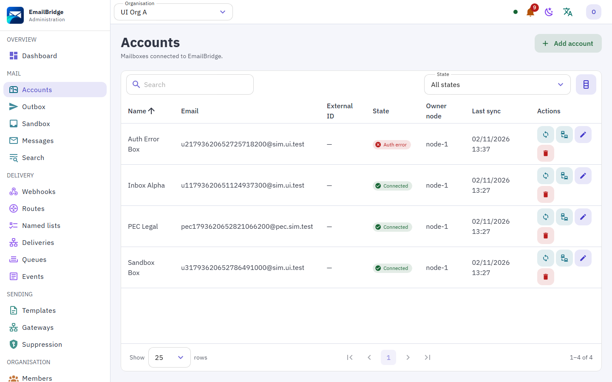 | 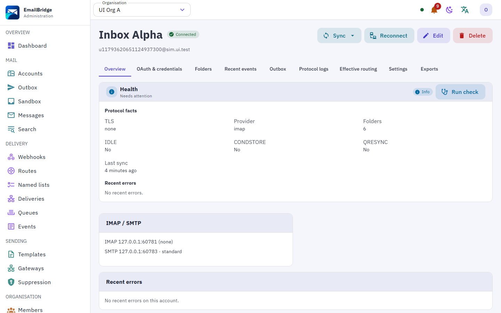 |
| **Accounts** — every connected mailbox and its sync state | **Account** — status, folders, events, outbox and logs |
| 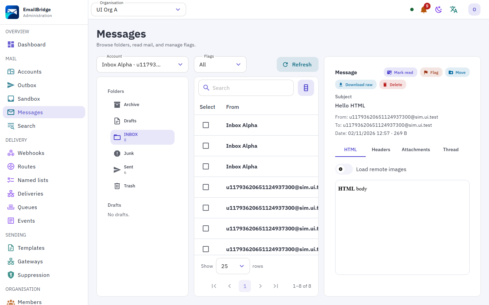 | 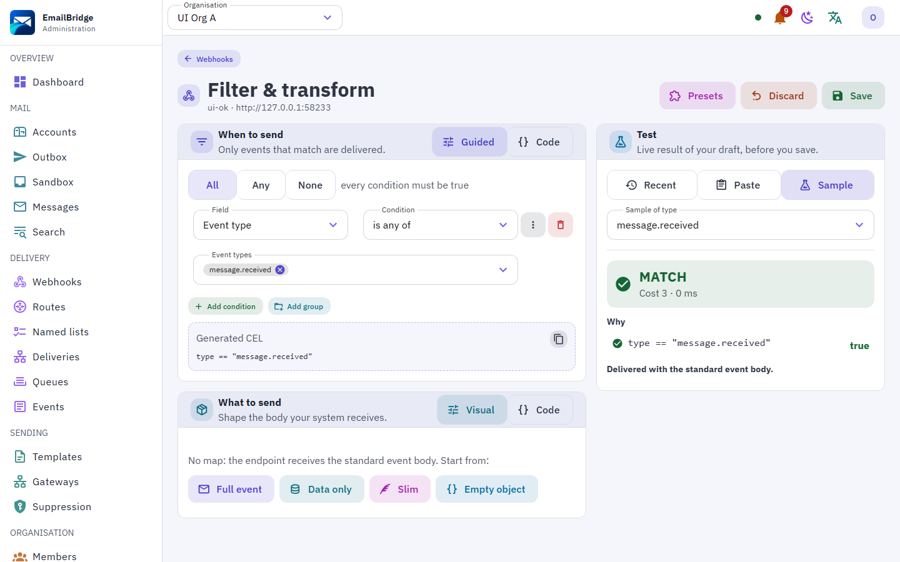 |
| **Messages** — browse folders and read mail in a safe reader | **Filter & transform** — visual rules for each webhook |
| 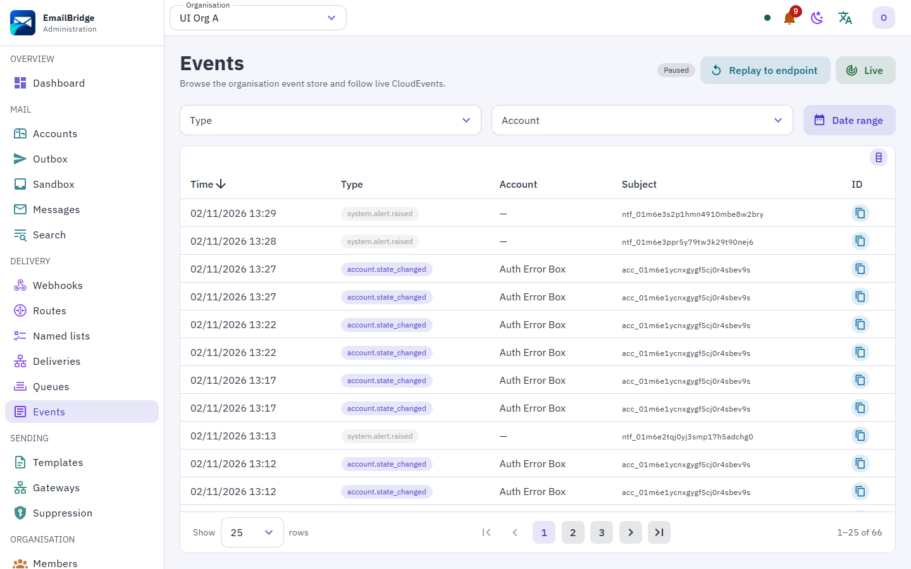 | 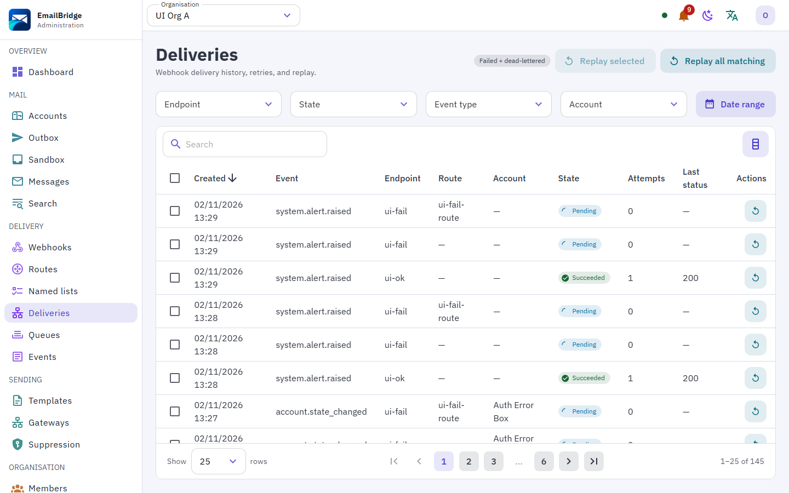 |
| **Events** — the live event stream | **Deliveries** — every webhook attempt, with replay |
| 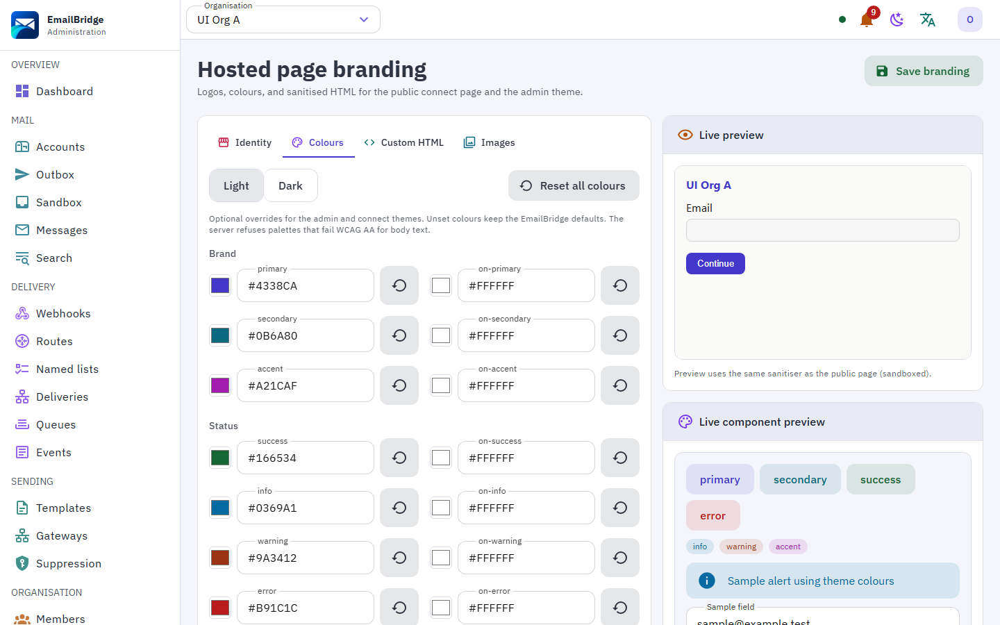 | 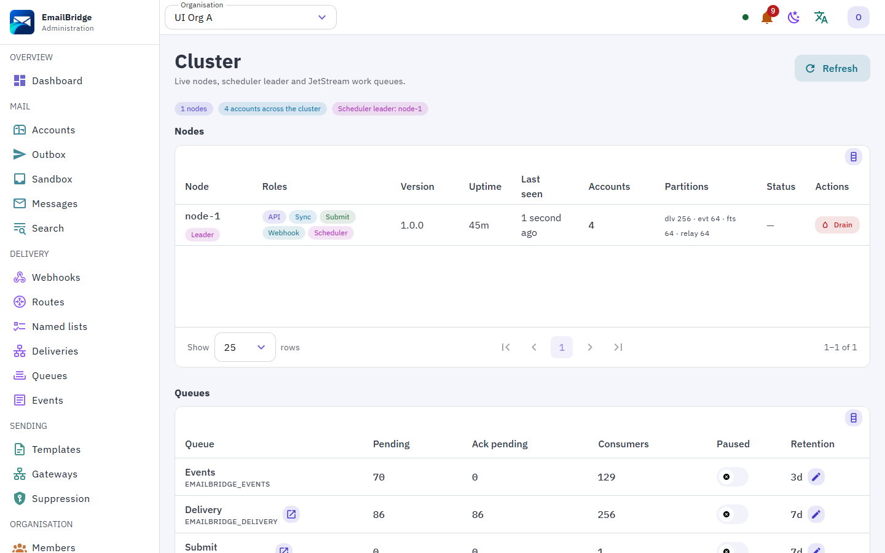 |
| **Branding** — your logo and colours on the hosted page | **Cluster** — nodes, roles and queues |
| 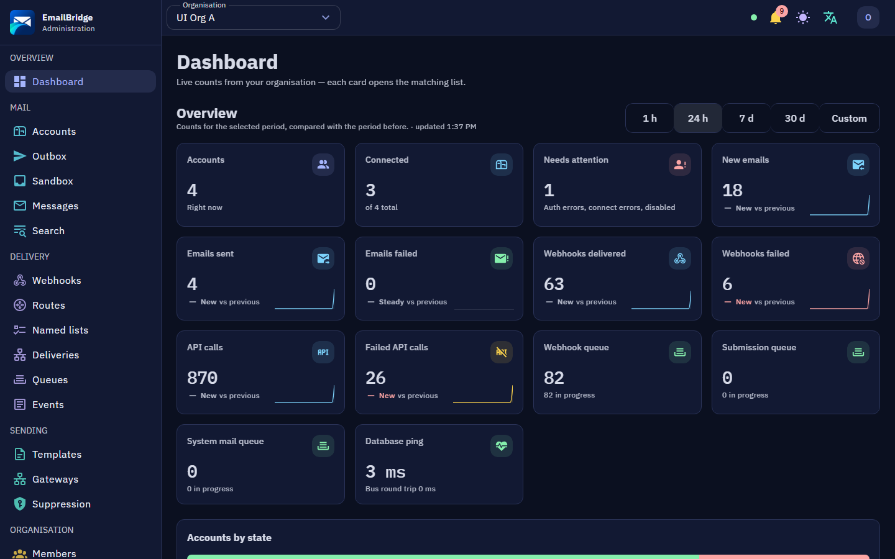 | 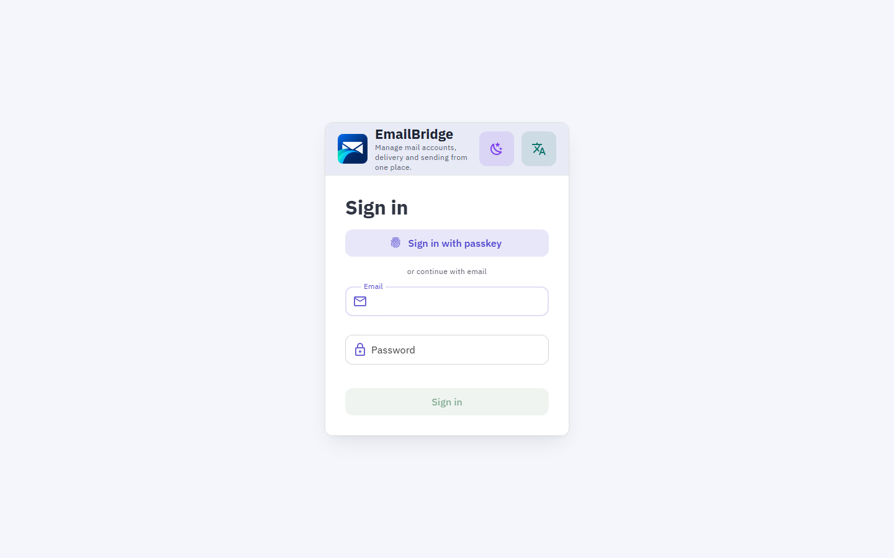 |
| **Dark theme** | **Sign-in** with passkeys, TOTP or SSO |

<p align="center">
  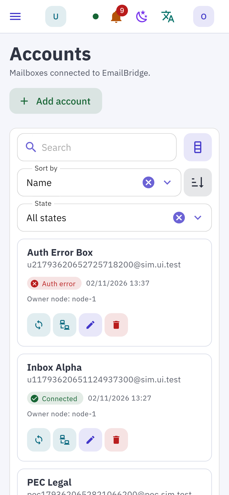
  &nbsp;&nbsp;
  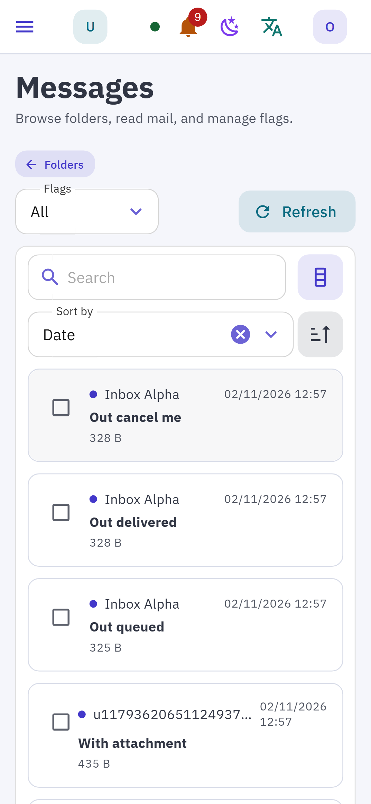
  <br>
  <em>The whole admin works on phones.</em>
</p>

## Quick start

EmailBridge needs **NATS**, **MongoDB** (replica set) and **S3-compatible storage**. The small Compose file
runs all of them next to one EmailBridge container.

```bash
# 1. Get the code and the binary (from the v1.0.0 release, or build it)
git clone https://github.com/radioBros/emailBridge.git && cd emailBridge
go build -o emailbridge ./cmd/emailbridge

# 2. Create the secrets the stack needs (written to ./secrets, mode 0600)
./emailbridge secrets init

# 3. Start the stack (Podman or Docker)
podman compose -p emailbridge --project-directory . -f deploy/compose/small.yml up -d
```

Open `http://127.0.0.1:8080`. For the first start, set `EB_BOOTSTRAP_OWNER_EMAIL` and
`EB_BOOTSTRAP_OWNER_PASSWORD` (and optionally `EB_BOOTSTRAP_ORG_NAME`) to create the first owner account,
then sign in and add a mailbox under **Accounts**.

Every setting is an `EB_*` environment variable (secrets also as `EB_*_FILE`); see the
[configuration reference](docs/site/content/configuration/index.md).

## Using the API

Create an API key in the admin UI (**API keys**), then call the REST API with it as a bearer token. The full
reference is the OpenAPI 3.1 document at [api/openapi/openapi.yaml](api/openapi/openapi.yaml), also served
by every node at `/v1/openapi.yaml`.

**Connect a mailbox**

```bash
curl -X POST http://127.0.0.1:8080/v1/accounts \
  -H "Authorization: Bearer $EB_API_KEY" -H "Content-Type: application/json" \
  -d '{
    "name": "Reception",
    "email": "reception@example.com",
    "imap": { "host": "imap.example.com", "port": 993, "tls": "implicit",
              "auth": { "user": "reception@example.com", "pass": "app-password" } },
    "smtp": { "host": "smtp.example.com", "port": 465, "tls": "implicit",
              "auth": { "user": "reception@example.com", "pass": "app-password" } }
  }'
```

**Send a message**

```bash
curl -X POST http://127.0.0.1:8080/v1/accounts/$ACCOUNT_ID/outbound-messages \
  -H "Authorization: Bearer $EB_API_KEY" -H "Content-Type: application/json" \
  -d '{
    "to": [{ "name": "Anna Rossi", "address": "anna.rossi@example.org" }],
    "subject": "Invoice 2026-1043",
    "text": "Please find the invoice attached."
  }'
```

The message goes into the durable queue; its progress arrives as `message.sent`, `message.failed` or
`message.bounced` events.

**SDKs** wrap the API and verify webhook signatures: [Go](sdk/go) · [TypeScript](sdk/typescript) ·
[Python](sdk/python) · [PHP](sdk/php).

## Webhooks

Add an endpoint under **Webhooks** (or `POST /v1/webhook-endpoints`), choose the events, and optionally a
rule that filters and reshapes them:

```json
{
  "name": "Helpdesk tickets",
  "kind": "http",
  "url": "https://helpdesk.example.org/hooks/email",
  "events": ["message.received"],
  "rule": {
    "filter": "type == \"message.received\" && isInbox() && fromDomain() == \"example.org\"",
    "map": "{\"messageId\": data.messageId, \"subject\": subject(), \"from\": from()}"
  }
}
```

Each delivery is signed following [Standard Webhooks](https://www.standardwebhooks.com) and carries a
CloudEvents envelope. Failed deliveries retry with backoff and can be replayed from the **Deliveries**
page. Coming from EmailEngine? See the
[migration notes for filter and map functions](docs/site/content/webhooks/filters.md).

## Deployment

| Setup | When | Guide |
| --- | --- | --- |
| Compose, small | One host, all roles in one container | [compose-small](docs/site/content/install/compose-small.md) |
| Podman Quadlet | One host under systemd, rootless | [deploy/quadlet](deploy/quadlet/README.md) |
| Compose, medium | Several nodes, NATS and MongoDB clusters, role split | [docs/ops/medium.md](docs/ops/medium.md) |
| Kubernetes | Helm chart | [deploy/helm/emailbridge](deploy/helm/emailbridge/README.md) |
| AWS | ECS Fargate with Terraform | [deploy/terraform/aws](deploy/terraform/aws/README.md) |

The same binary runs every role — `api`, `sync`, `submit`, `webhook`, `scheduler` — chosen with
`EB_ROLES`. Images are published as `ghcr.io/radiobros/emailbridge:v1.0.0` for amd64 and arm64.

## Documentation

- [Guides and reference](docs/site/content/index.md): install, configuration, API, webhooks, gateways,
  integrations, operations. Serve it locally with MkDocs ([docs/site/README.md](docs/site/README.md)).
- [Operations](docs/ops/README.md): sizing, observability, config as code, GDPR.
- [Error codes](docs/api/problems.md): every RFC 9457 problem code the API returns.
- [Changelog](CHANGELOG.md).

## Building from source

- Requirements: Go 1.27+, Node 22+ with pnpm.
- Backend: `go build ./cmd/emailbridge`. Tests: `go test ./internal/<package>/...`.
- Admin UI: `cd web && pnpm install && pnpm build`; build the binary with `-tags embedweb` to embed it.
- Development stack with the app, MongoDB, Dovecot and S3: `task dev:deps` (see [Taskfile.yml](Taskfile.yml)).
- A provider simulator (IMAP/SMTP, Gmail, Graph, PEC) for tests: [docs/ops/simulator.md](docs/ops/simulator.md).

## Contributing

Issues and pull requests are welcome. Keep changes covered by tests, and never commit secrets or real
mailbox credentials. Security issues: please report them privately through GitHub's security advisories
rather than a public issue.

## Licence

EmailBridge is free software under the [GNU Affero General Public License v3.0](LICENSE). If you run a
modified version as a network service, the AGPL requires you to offer its source to the service's users.
